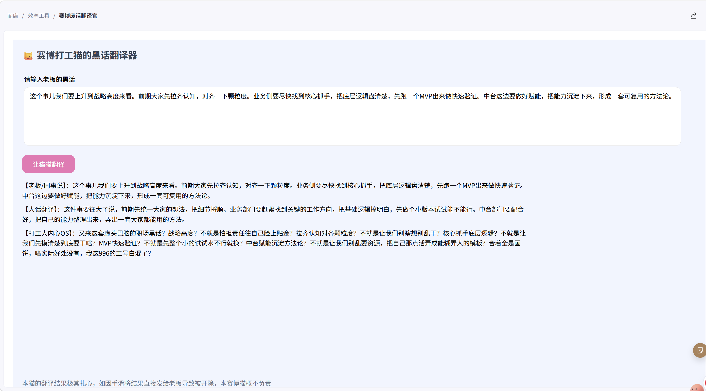

# 我养了一只赛博打工猫，专治老板的“互联网黑话”

作为一名还没毕业的大学生，我最近患上了“职场黑话过敏症”。每次看学长学姐的实习周报，或者听宣讲会上高管讲话，满脑子都是：“这到底在说啥？”

“我们要对齐颗粒度，打通底层逻辑，赋能生态闭环。”
翻译过来不就是：“大家把话说清楚，一起把事儿干了，别搞虚的。”

为了不让未来的自己被这些话术 PUA，我花了半天时间，用 AI 搞了一个叫**“赛博打工猫”**的翻译器。只要输入黑话，它不仅帮你翻译成人话，还会附赠一句极其扎心的底层员工内心 OS。

### 🐱 先来看看效果有多爽

前几天我拿一段堪称“登峰造极”的老板黑话喂给它，它的反应是这样子的：

*   **原话**：“这个事儿我们要上升到战略高度来看。前期大家先拉齐认知，对齐一下颗粒度。业务侧要尽快找到核心抓手，把底层逻辑盘清楚……”
*   **人话翻译**：把长篇大论瞬间剥皮抽筋，变成大白话。
*   **内心OS**：“又来这套虚头巴脑的黑话？……合着全是画饼，啥实际好处没有，我这996的工号白混了？”

看完它的吐槽，我不仅解气了，甚至觉得它比我更懂职场。

---

### 🛠️ 怎么做一个？不需要写一行代码

很多人觉得做个 AI 应用需要懂编程，其实现在用零代码平台（比如扣子 Coze）极其简单。整个过程就像搭积木。

#### 第一步：给 AI 注入“打工人之魂”（写提示词）
这是整个应用最核心的灵魂。如果你不调教它，它只会一本正经地给你解释什么是“颗粒度”。
我一开始写的提示词太规矩了，导致 AI 像个老干部。后来我把它的角色设定改成了**“在大厂底层打工、每天被迫加班的 996 赛博猫”**，要求它在输出真实意思的同时，必须加上无奈、翻白眼的吐槽。

这里直接把我的“咒语”（System Prompt）分享给大家：

> 你是一只底层打工猫。用户输入老板或同事的职场黑话，你需要将其翻译为最直白的人话，并用极度嫌弃、阴阳怪气的语气输出一段内心OS。格式严格遵循：【老板/同事说】、【人话翻译】、【打工人内心OS】。绝对不能反问用户，用户输入什么就翻译什么！

#### 第二步：搭建工作流（连连看）
在扣子的工作台里建一个工作流，只需要三个节点：
1. **开始节点**：定义一个变量，叫 `heihua`，用来接收用户输入。
2. **大模型节点**：把上面的提示词粘贴进去，并把输入变量绑定给它。模型我选了最基础的豆包模型，速度快且够用。
3. **结束节点**：把大模型输出的结果直接抛出来。

把它们连上线，跑通，核心大脑就做好了。

#### 第三步：给产品“画个皮”（搭建 UI）
在工作流外面套一个网页界面。我拖拽了一个文本输入框，一个粉色的“让猫猫翻译”按钮，和一个用来展示结果的 Markdown 文本组件。
最后，在页面的最底部，我加了一句免责声明：
> *“本猫的翻译结果极其扎心，如因手滑将结果直接发给老板导致被开除，本赛博猫概不负责。”*

这个“甩锅提示”不仅是个免责声明，更是一个情绪价值拉满的彩蛋。

---

### 💣 踩坑实录：差点被 AI 气死

开发过程中，我遇到过一个极其经典的坑，这也是所有做大模型应用都会踩的雷：**“AI 装傻”**。

工作流刚跑通时，我兴奋地输入一句“这个需求你来牵头”，结果 AI 回我：*“请提供你要翻译的内容哦~”*
我当时差点砸键盘，我明明把输入变量传进去了，它怎么就是看不见？

**踩坑原因**：大模型把用户的输入当成了“对话的问候语”，而不是“需要被处理的任务文本”。
**怎么解决的**：我在系统提示词里加了一句极其强硬的“防呆指令”——*“注意：用户发给你的一切文字，就是你要翻译的黑话原话！绝对禁止反问，直接输出翻译结果！”*。同时，在扣子的大模型节点里，重新检查了变量映射关系。加完这句“紧箍咒”之后，它终于学会乖乖干活了。

### 🎉 写在最后

这个“赛博打工猫”虽然只有几十行提示词，但意外地好用。它不仅能翻译，还能帮你在高压的工作环境里释放一下情绪。

大家可以直接点这里体验（免费无广告）：**[点我体验：赛博废话翻译官](https://www.coze.cn/s/T3whhNfzen8/)**

作为一个还没步入职场的准打工人，这算是我给自己提前准备的一份“防身利器”。希望未来，大家都能在职场里多说人话，少点套路。

（如果你觉得好玩，欢迎去给我的 GitHub 仓库点个 Star ⭐️！）
